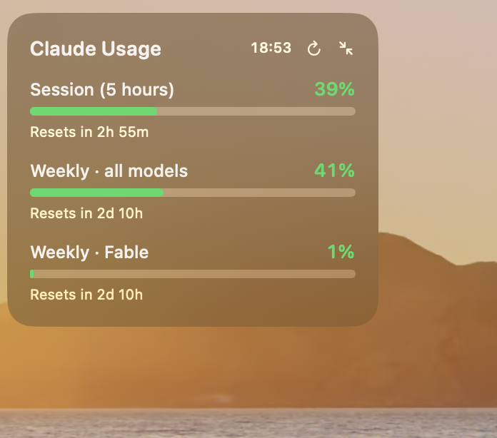
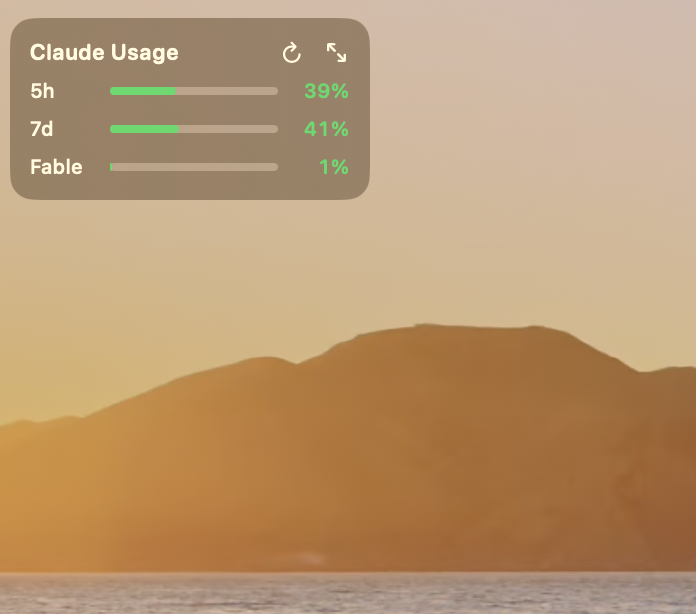

# Claude Usage for Nook

A tiny always-on-desktop widget that shows your **Claude subscription usage limits** — the same numbers you see under `/usage` in Claude Code or in claude.ai's *Settings → Usage*.

It is a [Nook](https://github.com/fatihsen-dev/nook) nooklet: a small native SwiftUI app that Nook builds and runs as its own process on macOS.

| Expanded | Compact |
| --- | --- |
|  |  |

## Features

- **Session (5 hours)** and **weekly** limits, plus any model-specific weekly limit your plan has (for example *Weekly · Fable*).
- Progress bar per limit, colored green → yellow (70%) → red (90%).
- Time until each limit resets ("Resets in 2h 55m").
- **Compact mode** — one line per limit; hover a row to see its reset time. The choice is remembered.
- Refreshes automatically every 3 minutes, or on demand with the ↻ button.
- Floats on the desktop level, can be dragged anywhere and remembers its position.

## Requirements

- macOS 14 or later
- Xcode or the Command Line Tools (Swift 6 toolchain)
- [Nook](https://github.com/fatihsen-dev/nook)
- [Claude Code](https://docs.anthropic.com/en/docs/claude-code) signed in with a Claude Pro / Max subscription (`claude` → `/login`)

## Install

```bash
git clone https://github.com/EmreKb/claude-usage-nook.git
```

Open Nook, add the cloned folder as a nooklet and press **Build / Run**.

To try it without Nook:

```bash
cd claude-usage-nook
swift run -c release ClaudeUsage
```

## How it works

1. Reads the Claude Code OAuth credential from the macOS Keychain (item `Claude Code-credentials`) using `/usr/bin/security`. The token is only read — never refreshed, written, logged or sent anywhere other than Anthropic.
2. Calls `GET https://api.anthropic.com/api/oauth/usage`, the endpoint behind the usage panel in Claude Code and claude.ai.
3. Renders the `limits` array from the response, so new limit types appear without code changes.

Claude Code refreshes its own token while you use it. If the token has expired, the widget asks you to run Claude Code once instead of refreshing it itself, so your CLI session is never disturbed.

## Caveats

- `/api/oauth/usage` is **undocumented** and may change or disappear without notice.
- The endpoint is rate limited; polling more often than every few minutes can return `429`.
- This project is not affiliated with or endorsed by Anthropic.

## Project layout

| File | Responsibility |
| --- | --- |
| `Sources/app.swift` | Nooklet entry point and floating panel |
| `Sources/usage-view.swift` | Expanded and compact SwiftUI views |
| `Sources/usage-model.swift` | Polling and view state |
| `Sources/usage-client.swift` | Usage API request and response parsing |
| `Sources/credential-store.swift` | Keychain credential lookup |

## Credits

Built on [Nook](https://github.com/fatihsen-dev/nook) by [Fatih Şen](https://github.com/fatihsen-dev).
